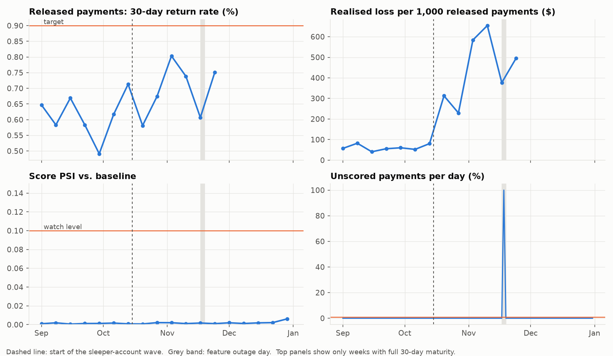
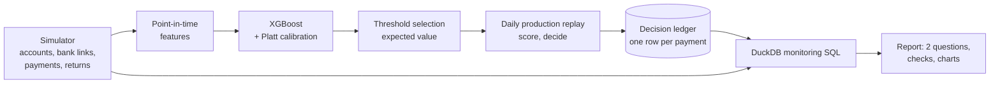
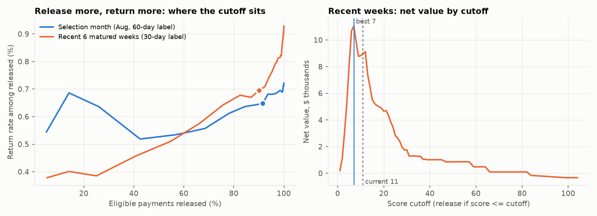
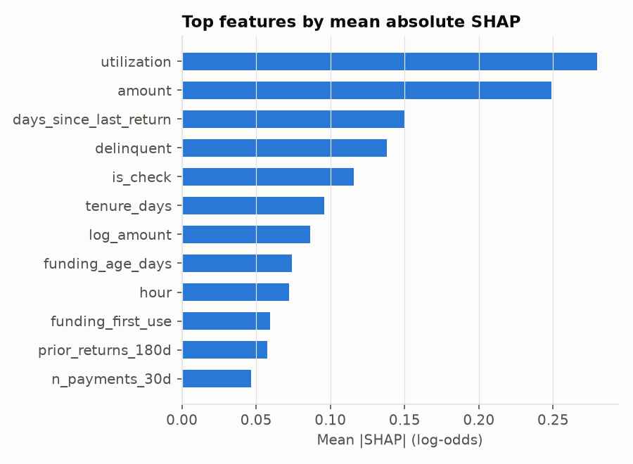

# Payment Float Risk

**Score credit card payments for return risk, decide when to release the credit hold, and monitor whether the strategy still works.**

End-to-end fraud-risk project on a fully synthetic card portfolio: simulator, point-in-time features, XGBoost with calibration, a rules-plus-score decision strategy, an idempotent decision ledger, SQL monitoring, and a report that answers the two questions every strategy owner gets asked:

1. **Is the strategy working as expected?**
2. **Are the thresholds still right?**


> **Portfolio / synthetic-data disclaimer.** All data is generated by `src/pfloat/simulate.py`. No real customer, company, bank, employer table, or production data is used anywhere in this repository. Policy thresholds, economics, scenarios, and outcomes are intentionally illustrative and do **not** reproduce any employer's production strategy.

---

## The problem

When a cardholder pays their bill by ACH or check, the balance drops right away but the payment can still bounce for days or weeks. If the issuer releases the freed-up credit immediately, a bad payment lets someone spend money they never paid. This is the cash-out step of **bust-out fraud and payment kiting**. So issuers hold the credit (the "float") until the payment clears.

Holding everyone is safe but frustrates good customers who paid and can't use their card. The goal is to **release the hold early for low-risk payments** without raising losses.

What makes it hard:

| Challenge | Where it shows up here |
| --- | --- |
| Rare events | 1.8% of payments return |
| Delayed labels | R01 returns land in days, R10 "unauthorized" returns up to 60 days later |
| Adaptive adversaries | A wave of dormant accounts starts kiting mid-year, built to slip past the rules |
| Friction vs. loss | Every hold has a customer cost; every wrong release has a dollar cost |

## Headline results

On 20,000 synthetic accounts and 478,228 payments, with production replayed day by day from September:

- **Model:** XGBoost with Platt calibration achieved an out-of-time **AUC of 0.778 and KS of 0.429**. On the selection month, the observed return rate was **1.90%** versus a mean calibrated prediction of **1.92%**.
- **Strategy:** the rules-plus-score policy released **47.0%** of production payments, with **zero mismatches** between production decisions and the independent SQL re-derivation of the policy.
- **Monitoring detected both injected failures:**
  - a one-day feature outage, where the unscored rate reached **100%**;
  - a sleeper-account kiting wave that increased realized loss per 1,000 released payments to **$446**, or **7.7x the pre-drift level**.
- **Why this matters:** the count-based released return rate remained within target at **0.69%**, weekly AUC stayed above target at **0.755**, and score PSI remained low at **0.006**. Model-health metrics alone would not have identified the economic deterioration.
- **Threshold review:** on the most recent matured window, the current score cutoff of **11** was no longer optimal; the best recent cutoff was **7**. The synthetic amount-cap review also favored a tighter cap, with the best tested combination improving net value by approximately **$7.2k** over the evaluation window.

The monitoring result is a **challenger recommendation**, not an automatic production change. In a live environment, the tighter strategy would be validated through back-testing and a controlled champion/challenger rollout before full deployment.



---

## How it works



### The decision strategy

Each payment walks these rules in order; the first match wins (`src/pfloat/strategy.py`):

| Order | Rule | Decision |
| --- | --- | --- |
| 0 | Not scored (pipeline failure) | Hold |
| 1 | Account status unknown | Hold |
| 2 | Account delinquent | Hold |
| 3 | Any return on the account in the last 180 days | Hold |
| 4 | Amount at or over $300 | Hold |
| 5 | Score above cutoff | Hold |
| 6 | Otherwise | **Release** |

Rules handle what policy should never delegate to a model; the score handles the rest. The cutoff is chosen by maximizing expected net value on an out-of-time month (`src/pfloat/threshold.py`):

```text
net value = value_per_release x good payments released
          - sum(amount x spend_share x (1 - recovery)) over returned payments released
```



### Model

| Split | Period | AUC | KS | Bad rate | Mean predicted |
| --- | --- | --- | --- | --- | --- |
| Train | Jan to Jun | 0.801 | 0.446 | 1.77% | 1.74% |
| Selection (out of time) | Aug | 0.778 | 0.429 | 1.90% | 1.92% |

<p>


</p>

- **Label:** returned within 60 days of the payment, covering the R10 tail. Payments younger than 60 days are unlabelled, never counted as good.
- **Features (27):** payment (amount, ratio to balance and minimum due, check vs. ACH, channel, hour); account (tenure, utilization, delinquency); funding bank account (age, first use, links in 90 days); velocity (payments and dollars in 7 and 30 days); prior returns (90 and 180 days, days since last).
- **Imbalance:** `scale_pos_weight`, which inflates raw probabilities. A Platt calibrator fit on a later month maps them back to calibrated risk.
- **Explainability:** mean |SHAP| from XGBoost's built-in TreeSHAP.

---

## Design decisions worth reading

These are the choices that separate a production system from a notebook.

1. **Point-in-time features.** Every window feature counts only events strictly before the payment timestamp, using `merge_asof` on per-account cumulative counts (`features.py`). A return is only known once it has happened. Tests in `tests/test_features.py` check that future events, same-timestamp events and other accounts never leak.
2. **Out-of-time splits, not random.** Train on Jan to Jun, calibrate on Jul, choose the threshold on Aug, judge on production months. Fraud drifts; random splits flatter the model.
3. **No reject inference needed for the label.** A payment returns or not regardless of whether its credit was held, so outcomes are observed for every payment. Only loss depends on the decision, which is why the threshold analysis models spend and recovery explicitly.
4. **One definition of the policy.** Decisioning and threshold analysis use the same Python strategy implementation. Monitoring independently re-derives the rules in SQL as a reconciliation control. Any gap appears as a policy mismatch, and the target is zero.
5. **Idempotent ledger.** Decision IDs are UUIDv5 of the payment ID, and upserts dedupe within and across batches. A rerun can never create a second release request (`tests/test_strategy_and_ledger.py`).
6. **Fail loudly on missing features.** The scorer raises instead of silently filling missing values. During the simulated outage, payments are held as unscored and the unscored-rate check fires.
7. **Mature before you judge.** Return flags are `NULL` until a payment is old enough for that window, so recent cohorts do not look artificially clean.
8. **Fixed decile cutoffs.** PSI and deciles use cutoffs frozen from a baseline period, so weeks are comparable over time.
9. **Count and sum in SQL, compute rates after.** Rates are never averaged across segments.
10. **Dollars, not just counts.** The kiting wave pays just under the illustrative $300 cap. Count-based return rates stay near target while dollar losses jump. Both are monitored.

## The synthetic world

`simulate.py` builds a portfolio with the mechanics that matter:

- 20,000 accounts with credit lines, utilization, monthly delinquency snapshots and linked bank accounts.
- About 2 payments per account per month: minimum, full-balance or partial amounts.
- **149 bust-out accounts:** fresh bank links, high utilization, large payments, a 29% return rate, and rapid spending after released credit.
- **82 sleeper accounts** that wake up after 2025-10-15. Each generates a concentrated payment-kiting pattern just below the illustrative cap, from aged bank accounts, via the app, with clean history.
- **Return codes and lags:** R01/R02/R03 in 1 to 4 days (3 to 10 for checks), R10 in 10 to 60 days. Returns after the as-of date are not yet observed.
- **Hidden truth** (`data/truth/`) holds latent risk, fraud flags, spend share and recovery. It is used only for loss accounting and evaluation, never as a model feature.

## Quickstart

### Windows (PowerShell / Anaconda Prompt)

```bash
git clone https://github.com/FatemehFirouzi/payment-float-risk.git
cd payment-float-risk
python -m venv .venv
.venv\Scripts\activate
python -m pip install -e ".[dev]"
python -m pfloat all --config config/default.yaml
python -m pytest -q
python -m ruff check src tests
```

### macOS / Linux

```bash
git clone https://github.com/FatemehFirouzi/payment-float-risk.git
cd payment-float-risk
python -m venv .venv && source .venv/bin/activate
make install
make all
make test
make lint
```

Each stage also runs independently:

```text
python -m pfloat <simulate|features|train|select-threshold|production|monitor|report>
```

The output is `reports/monitoring_report.md` plus charts in `reports/figures/`. Change any illustrative threshold or target in `config/default.yaml` and rerun.

## Repository layout

```text
config/            default.yaml (full run), ci.yaml (fast run for tests)
src/pfloat/
  simulate.py      synthetic portfolio and return mechanism
  features.py      point-in-time features and maturity-aware labels
  model.py         XGBoost, Platt calibration, SHAP, save/load, scoring
  strategy.py      policy rules
  threshold.py     cutoff trade-off on expected net value
  ledger.py        idempotent decision ledger
  pipeline.py      stages and daily production replay
  monitoring.py    runs SQL in DuckDB
  report.py        checks against targets, charts, markdown report
sql/               01_base, 02_daily, 03_performance, 04_psi, 05_discrimination
tests/             features, metrics, strategy and ledger, end-to-end pipeline
reports/           generated report and figures committed for GitHub rendering
```

The SQL is plain DuckDB over named tables and ports to Spark or Databricks SQL with small changes (`ASOF JOIN` and list lambdas are the DuckDB-specific parts).

## Limitations and next steps

- **Synthetic data.** The mechanics are realistic, but every number comes from the simulator. Real projects need real return codes, card transactions for spend, and recovery data.
- **Daily batch.** Real-time scoring at payment initiation would let holds apply before the first release.
- **No reconciliation loop yet.** Production systems also need a job that checks the release actually happened in core and retries safely, with a retry cap and payment-state check.
- **Retraining.** The wave would warrant a challenger model with velocity-by-amount interactions and a champion/challenger test before rollout.
- **Consortium signals.** Cross-lender information about a funding account could materially improve detection of sleeper behavior.

## License

MIT. See [LICENSE](LICENSE).
