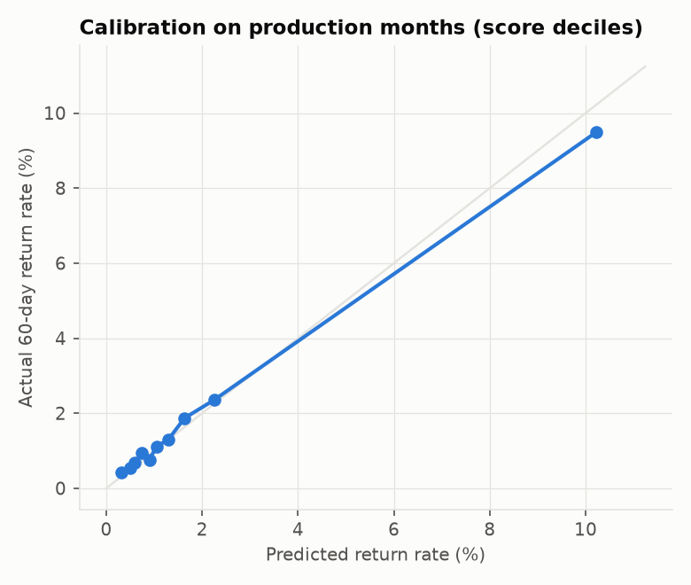

# \## Headline results

# 

# On 20,000 synthetic accounts and 478,228 payments, with production replayed day by day from September:

# 

# \- \*\*Model:\*\* XGBoost with Platt calibration achieved an out-of-time \*\*AUC of 0.778 and KS of 0.429\*\*. On the selection month, the observed return rate was \*\*1.90%\*\* versus a mean calibrated prediction of \*\*1.92%\*\*.

# \- \*\*Strategy:\*\* the rules-plus-score policy released \*\*47.0%\*\* of production payments, with \*\*zero mismatches\*\* between production decisions and the independent SQL re-derivation of the policy.

# \- \*\*Monitoring detected both injected failures:\*\*

# &#x20; - a one-day feature outage, where the unscored rate reached \*\*100%\*\*;

# &#x20; - a sleeper-account kiting wave that increased realized loss per 1,000 released payments to \*\*$446\*\*, or \*\*7.7x the pre-drift level\*\*.

# \- \*\*Why this matters:\*\* the count-based released return rate remained within target at \*\*0.69%\*\*, weekly AUC stayed above target at \*\*0.755\*\*, and score PSI remained low at \*\*0.006\*\*. Model-health metrics alone would not have identified the economic deterioration.

# \- \*\*Threshold review:\*\* on the most recent matured window, the current score cutoff of \*\*11\*\* was no longer optimal; the best recent cutoff was \*\*7\*\*. The synthetic amount-cap review also favored a tighter cap, with the best tested combination improving net value by approximately \*\*$7.2k\*\* over the evaluation window.

# 

# The monitoring result is a \*\*challenger recommendation\*\*, not an automatic production change. In a live environment, the tighter strategy would be validated through back-testing and a controlled champion/challenger rollout before full deployment.

# 

# !\[Weekly monitoring](reports/figures/weekly\_monitoring.png)

# 

# \---

# 

# \## How it works

# 

# ```mermaid

# flowchart LR

# &#x20;   A\[Simulator<br/>accounts, bank links,<br/>payments, returns] --> B\[Point-in-time<br/>features]

# &#x20;   B --> C\[XGBoost<br/>+ Platt calibration]

# &#x20;   C --> D\[Threshold selection<br/>expected value]

# &#x20;   D --> E\[Daily production replay<br/>score, decide]

# &#x20;   E --> F\[(Decision ledger<br/>one row per payment)]

# &#x20;   F --> G\[DuckDB monitoring SQL]

# &#x20;   A --> G

# &#x20;   G --> H\[Report: 2 questions,<br/>checks, charts]

# ```

# 

# \### The decision strategy

# 

# Each payment walks these rules in order; the first match wins (`src/pfloat/strategy.py`):

# 

# | Order | Rule | Decision |

# | --- | --- | --- |

# | 0 | Not scored (pipeline failure) | Hold |

# | 1 | Account status unknown | Hold |

# | 2 | Account delinquent | Hold |

# | 3 | Any return on the account in the last 180 days | Hold |

# | 4 | Amount at or over $300 | Hold |

# | 5 | Score above cutoff | Hold |

# | 6 | Otherwise | \*\*Release\*\* |

# 

# Rules handle what policy should never delegate to a model; the score handles the rest. The cutoff is chosen by maximizing expected net value on an out-of-time month (`src/pfloat/threshold.py`):

# 

# ```text

# net value = value\_per\_release x good payments released

# &#x20;         - sum(amount x spend\_share x (1 - recovery)) over returned payments released

# ```

# 

# !\[Threshold trade-off](reports/figures/threshold\_tradeoff.png)

# 

# \### Model

# 

# | Split | Period | AUC | KS | Bad rate | Mean predicted |

# | --- | --- | --- | --- | --- | --- |

# | Train | Jan to Jun | 0.801 | 0.446 | 1.77% | 1.74% |

# | Selection (out of time) | Aug | 0.778 | 0.429 | 1.90% | 1.92% |

# 

# <p>

# 

# 

# </p>

